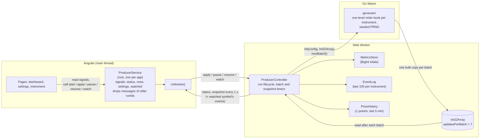

# Implementation details

How the requirements in [requirements.md](requirements.md) are met. Requirement IDs are given in brackets.

## Architecture



The module boundaries are typed contracts:

- **Wasm ↔ worker:** `WasmProducer` in `src/app/producer/wasm-api.ts`.
- **Worker ↔ UI:** `ToWorker` / `FromWorker` / `ProducerConfig` in `src/app/producer/protocol.ts`.

Key decisions:

- **Wasm in Go** with the standard toolchain (`GOOS=js GOARCH=wasm`). All randomness and price logic run in Go, from a seeded PCG [W12, W14].
- **Transport:** `Int32Array`, 7 ints per update, not JSON [W15].
- **Metrics live in the worker.** The UI only formats them [K01–K11].
- **Runs:** every message carries a `runId`; the worker and the UI both drop other runs [K16, K19, U05].
- **One producer:** a root Angular service owns the only worker, so navigation never creates another [U02].
- **Instruments:** real S&P 500 tickers from `public/resources/sp500.json`, sliced by the UI and sent in `ProducerConfig` [C01–C05, U09].

### Source layout

```
wasm/main.go                    JS bridge (syscall/js), memory model docs
wasm/generator/                 market model: config.go, book.go, generator.go, encode.go (+ tests)
public/resources/sp500.json     instrument list (fetched at runtime)
src/environments/environment.ts the only reader of import.meta (base URL, wasm URL, refresh rate)
src/app/producer/               protocol, wasm contract, worker (controller, metrics, event log, loader), service, rxWorker
src/app/shared/                 cents and bigint pipes, formatBigInt
src/app/settings/               signal-forms settings schema
src/app/pages/                  index.page.ts (dashboard), settings.page.ts, instrument/[symbol].page.ts (Tailwind only)
src/app/shell/                  status-bar/, status-badge/, producer-toggle/ (one folder per component, own SCSS)
src/app/dashboard/              market-table/
src/app/instrument/             price-chart/ (Chart.js adapter), event-table/
src/testing/                    test fixtures (producer stub, fake worker)
```

## Market update generation

Code: `wasm/generator/generator.go` (`NextBatch`) and `book.go`. Every number is in `ModelConfig` / `DefaultModelConfig()` (`config.go`) [W25].

### Model

Each instrument has a **one-level order book**: best bid and best ask, with the shares resting at each. Prices are integer cents, sizes are money budgets in cents, relative distances are basis points (1 bp = 0.01%, never less than 1¢).

| Setting | Default | Meaning |
|---|---|---|
| `Min/MaxStartPriceCents` | $10–$500 | starting mid price |
| `Min/MaxOrderCents` | $100–$5,000 | budget of one maker or taker order |
| `Min/MaxDepthCents` | $5k–$50k | money resting on a freshly made level |
| `LevelGapBps` | 5 | distance of a new level from an exhausted one |
| `InitialSpreadBps` | 5 | starting spread |
| `MaxSpreadBps` | 20 | spread cap |
| `SweepChancePct` | 10 | chance that a taker empties the level |
| `Min/MaxRestoreTicks` | 1–20 | updates of that instrument before the other side follows a move |

**Start of a run (`New`).** Per instrument: a random mid in the start range, spread = 5 bps of the mid, `bid = mid − spread/2`, `ask = bid + spread`. Each side gets a random depth budget converted to shares.

### One update

`NextBatch` fills the requested number of updates [W02]. Each update runs these steps, drawing random numbers in a fixed order so a seed always gives the same stream [W12]:

1. **Pick an instrument** uniformly at random. An instrument can repeat in a batch or be missing from it [W05].
2. **Refresh an exhausted level** [W24]. If the ask has 0 shares, it moves up one gap (`ask += 5 bps of ask`) with fresh depth. If the bid has 0 shares, it moves down one gap, never below 1¢ [W06].
   - **Clamp the spread.** If the spread is now above the cap (20 bps of the ask), the side that did not move is pulled toward the one that did [W07].
   - **Note the move.** The first move remembers the spread from before it and starts a wait of 1–20 updates of this instrument [W28].
3. **Otherwise count down a pending wait.** When it ends and the spread is still wider than before the move, the side opposite the last move gets a new level (fresh depth) at the old spread [W28]. That is how a price move "completes": first one side jumps, later the other follows.
4. **Maker:** a random side gets `budget / price` more shares at its best price [W26].
5. **Taker:** a random side is hit. A buyer takes from the ask, a seller from the bid [W08]. It fills `min(budget / price, shares at the level)` and the rest is cancelled [W23]. A budget smaller than the price still buys one share [W09].
   - **Sweep:** with `SweepChancePct` (10%) the budget is the whole level's value plus a normal order, so the level is emptied [W27]. That is the only thing that moves prices.
6. **Emit** `[instrument, tradePrice, filled, bid, ask, bidQty, askQty]`. The quantities are after the fill, so an emptied level shows 0 (imbalance ±1.00). It moves at that instrument's next update (step 2), which keeps the trade price equal to this update's bid or ask. Quantities saturate at `int32` max for the wire format. Prices are not saturated: the book keeps them as `int64` and they are cast to `int32` on the wire, so a price that random-walks above $21,474,836.47 (2³¹ − 1 cents) would wrap to a negative value. Starting at $10–$500 and moving 5 bps per exhausted level, that needs tens of thousands of net upward moves of one instrument, far beyond a realistic run, so it is a documented limit rather than handled.

Measured behaviour with one instrument over 100k updates: the spread is 4.6 / 9.3 / 18.6 bps at p10 / median / p90, bid or ask changes on 15% of updates, and one side shows 0 shares on 10.5%.

### Example

ALFA, in the middle of a run: `bid $101.96 × 300 | ask $102.00 × 250` (spread 4¢). Only ALFA's updates are shown; other instruments' updates can come in between, also across batches.

| # | What happens | Emitted update | Book after |
|---|---|---|---|
| 1 | No level is empty, no wait. Maker adds $1,500 on the bid: 150000 / 10196 = 14 shares. Taker buys for $2,040: 204000 / 10200 = 20, the ask has 250, so 20 fill. | `10200, 20, 10196, 10200, 314, 230` | `$101.96 × 314 \| $102.00 × 230` |
| 2 | Maker adds $1,000 on the ask: 9 shares → 239. Taker buys with a **sweep**: budget = $500 + 239 × $102.00 = $24,878 → 243 shares wanted, 239 available, so 239 fill. | `10200, 239, 10196, 10200, 314, 0` (imbalance +1.00) | `$101.96 × 314 \| $102.00 × 0` |
| 3 | The ask is empty: it moves one gap, 5 bps of 10200 = 5¢, to $102.05 with $20,000 of depth → 195 shares. Spread 9¢ is under the cap (20 bps of 10205 = 20¢). The move starts a wait of 3 updates and remembers the old spread, 4¢. Maker adds $800 on the bid → 7 shares. Taker sells for $3,000: 29 shares at the bid. | `10196, 29, 10196, 10205, 292, 195` | `$101.96 × 292 \| $102.05 × 195` |
| 4–5 | Wait 3 → 2 → 1. Maker and taker as in update 1. | trades at $101.96 / $102.05 | spread stays 9¢ |
| 6 | Wait 1 → 0. The spread (9¢) is wider than before the move (4¢), and the ask moved last, so the bid follows: a new bid level at 10205 − 4 = $102.01 with fresh depth. Then maker and taker as usual. | trade at $102.01 or $102.05 | `$102.01 × … \| $102.05 × …` |

After update 6 both quotes are 5¢ higher than before update 2 and the spread is back to 4¢. Downward moves are the same with sides swapped.

### Bridge and memory model

`wasm/main.go` registers `globalThis.producer = { init, nextBatch }` [W17].

**Why 7 numbers per update.** An update carries exactly the fields of a market update in the task, each as one int32 [W15]:

| # | Field | Note |
|---|---|---|
| 0 | `instrumentIndex` | index into `ProducerConfig.symbols` instead of the `"ALFA"` string, so every field is a number |
| 1 | `priceCents` | trade price |
| 2 | `tradeQuantity` | trade size |
| 3 | `bidCents` | best bid |
| 4 | `askCents` | best ask |
| 5 | `bidQuantity` | shares at the best bid |
| 6 | `askQuantity` | shares at the best ask |

Everything is an integer (prices in cents [W13]), so one `Int32Array` holds a whole batch with no strings and no JSON. int32 is wide enough: prices up to $21 million, and book quantities saturate at the int32 maximum. The result is 28 bytes per update, at most 28 KB per batch and about 560 KB/s at the highest rate.

1. The worker allocates **one `Int32Array` per run** (`updatesPerBatch × 7` elements) and passes it to `init` [K23].
2. `syscall/js` can only copy in bulk into a `Uint8Array` (`js.CopyBytesToJS`), so `init` creates a `Uint8Array` **view** over the same memory: `dst.buffer` from `dst.byteOffset`, `updatesPerBatch × 28` bytes. It is a view, not a copy, and it never reaches past the batch [W20].
3. `nextBatch()` fills a reused Go slice, encodes it as little-endian int32 into a reused `[]byte` and does **one** `CopyBytesToJS` (at most 28 KB) [W15, W16]. The worker then reads the values through its `Int32Array`.
4. Wasm is little-endian and typed arrays use the platform's byte order, so the worker checks for little-endian at load time instead of assuming it [K22].

Rejected: writing element by element with `dst.SetIndex` (7,000 JS calls per batch), and reading Go's linear memory from JS by pointer (depends on `wasm_exec.js` internals; the view detaches when Go's memory grows).

## Go GC issue

**Symptom.** A long run at the largest settings (50 instruments, 1000 updates / 50 ms) grew the Wasm memory to about 26 MB, although the generator allocates nothing per batch [W16].

**Cause.** Every call into a `js.FuncOf` function wraps the event, `this` and the arguments in `js.Value`s. Their finalizer records live **off the Go heap** (about 165 bytes per call) and are freed only after a GC. Because the Go heap itself does not grow, the GC never triggers, so the records pile up. This is a known runtime issue: [golang/go#74342](https://github.com/golang/go/issues/74342).

**Fix.** `nextBatch` forces `runtime.GC()` every 1000 batches (`batchesPerGC` in `wasm/main.go`), as suggested by a Go runtime maintainer in that issue. At the fastest rate that is one GC every 50 seconds, on a heap of a few KB.

**Test.** `memory.integration.spec.ts` [K32] runs the compiled module for 5 million updates at the largest settings and checks that the JS heap grows by less than 2 MB and the Wasm memory does not grow at all.

## Performance

The ceiling is 1000 updates every 50 ms, i.e. 20,000 updates/s. The UI must stay usable at that rate [U21].

- **Nothing is allocated per batch.**
  - Go reuses its update slice and byte buffer, the worker reuses its `Int32Array` [W16, K23].
  - `MetricsStore`, `EventLog` and `PriceHistory` keep fixed-size typed arrays per instrument (ring buffers for the last 100 events and the last 300 seconds) [K11, K25, K30].
  - The only per-update allocation left is the `BigInt` arithmetic for exact totals [K09].
- **One bulk copy per batch** from Go to JS, at most 28 KB.
- **Batches are folded synchronously**, before the next timer fires. The batch timer is a chained `setTimeout`, so batches never overlap [K13].
- **The UI refresh rate is fixed.** The worker posts one snapshot per `environment.uiRefreshMs` (1 s) whatever the generation rate, so Angular renders at most once a second. Every trade is still counted in volume and VWAP [K13].
- **Snapshots are small.** They hold one computed row per instrument (at most 50), plus the events of only the one symbol an instrument page watches [K28, K31]. BigInt survives structured clone, so no string encoding is needed.
- **Startup never blocks.**
  - Pages are prerendered and hydrated. The producer loads after the first render (`afterNextRender`) [U26, U27].
  - The worker is a lazy `?worker` chunk. Chart.js is loaded lazily, in the browser only [U40].
- **Memory stays flat** on long runs (see [Go GC issue](#go-gc-issue)) [K32].

## Error handling

Every failure ends as a readable `error` status with text, shown in the status bar instead of an endless skeleton [U07, U16].

| Layer | Failure | Handling |
|---|---|---|
| Settings form | Non-integer, empty or out-of-range value | Readable field error; Apply is disabled [U17, U18, U20] |
| Go `init` | Bad settings, bad config object, bad output buffer | Returns an error string instead of panicking (a `recover` also catches `syscall/js` panics from wrong argument types). Everything that can fail runs before the run state is replaced, so a rejected `init` keeps the previous run [W03, W04, W18, W19, W21] |
| Go `nextBatch` | Called before a successful `init` | No-op [W22] |
| Wasm loader | Big-endian platform, HTTP error, invalid binary, module never registers the API | Rejects with `Failed to load <url>: HTTP 404`, `Failed to start <url>: …` and so on [K21, K22] |
| Wasm loader | Host serves `.wasm` without `application/wasm` | Falls back from `instantiateStreaming` to `instantiate(arrayBuffer)` [K33] |
| Worker controller | Loader rejected, `init` returned an error or threw (e.g. the Go runtime exited) | Posts `status: 'error'` with the text and starts no timers [K18] |
| Worker controller | Messages for an older run; an older Apply still waiting for Wasm | Ignored [K19] |
| `ProducerService` | Instrument list fails to load | Error status; a worker that was already created is terminated [U07] |
| `ProducerService` | Worker chunk fails to load, or the worker crashes (`error` / `messageerror`) | Error status; the dead channel is dropped, and the next Apply loads a new worker [U07, U24] |
| `ProducerService` | Messages from an older `runId` | Dropped [U05] |
| `ProducerService` | App destroyed (also while loading) | Worker terminated, timers stopped [U08, K20] |
| Status bar | Any error status | The run control turns into **Retry**: reload when no run was started yet, otherwise restart the run [U49] |

## Instrument (chart) page

`/instrument/:symbol` shows a ticker's current spread, a price chart (trade price as dots, bid and ask as straight lines between updates), a spread chart and a log of its last 100 updates, newest first. The charts have Live (last 100 events), 60 s and 5 min windows; the time windows use one point per second [U37–U47].

The page was built to **debug and tune the generator**, not as a product feature. Watching single updates made model problems visible that the dashboard's aggregates hide: an emptied level showing ±1.00 imbalance, quotes moving on almost half the updates, and the spread sitting at the cap. The sweep step [W27] and the delayed return of the other side [W28] were tuned on it.

So it is off by default. The "Show charts" toggle on the settings page turns it on; while it is off, a route guard sends the page to the dashboard and the table symbols are plain text [U48].
